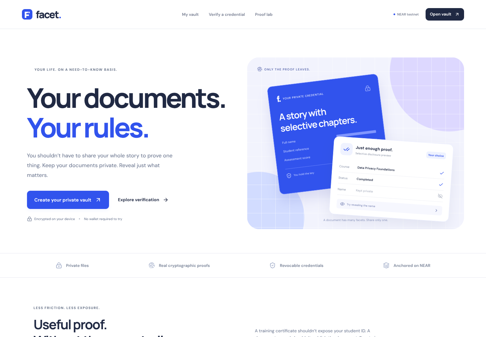
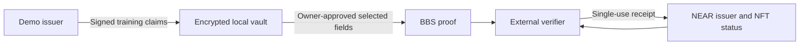

# Facet

**Prove a qualification without handing over your entire document.**

[Try the live app](https://facet-near.vercel.app) · [Watch the narrated demo](https://facet-near.vercel.app/media/facet-demo.mp4) · [Test evidence](deployments/verification.json)

A hiring team needs to know whether you completed a course. It does not need your grade, student number, or the original certificate. Facet lets you approve the exact fields it receives, while a verifier checks the issuer’s signature and current credential status.

The working NEAR testnet prototype combines a password-protected document vault, holder-bound credential NFTs, real BBS selective-disclosure proofs, and single-use verification receipts. You can try the sponsored demo without a blockchain wallet.



## A concrete example

| Person or organization | What they do | What the prototype demonstrates |
| --- | --- | --- |
| Learner | Prove training completion to a hiring team | Share course and completion; hide name, score and student reference |
| Document owner | Preserve private training notes | Encrypt the original locally; record a salted fingerprint as a self-recorded NFT |
| External verifier | Check a proof in a separate browser | Verify approved claims without opening the owner’s vault |
| Credential owner | Withdraw a credential from future use | Revoke its NEAR record; subsequent verification rejects it |

**The issuer is fictional Facet Test Academy.** An arbitrary uploaded document stays explicitly **self-recorded and unverified**. Recording an NFT does not establish that a passport, degree or certificate is genuine. Real university, employment and membership integrations are future work. [More use cases and their limits](docs/USE_CASES.md).

## Try it: do this → see this

Use fictional files for the public demo. Open [My vault](https://facet-near.vercel.app/vault).

1. Create a vault password → an encrypted local vault opens. Save an encrypted backup and keep your password.
2. Upload a small file; choose **Create private NFT** → its original remains local and its record says **Self-recorded · unverified**.
3. Choose **Issue demo credential** → a fictional training credential receives a real issuer signature and a NEAR NFT.
4. Choose **Prove selected fields**; create a request for course and completion → the consent preview distinguishes revealed and hidden fields.
5. Approve and **Export proof** → the proof contains approved claims and required public bindings, without the learner’s name or score.
6. Open [Verify](https://facet-near.vercel.app/verify) in another browser, import that proof, and click **Verify proof** → signature, holder approval and live credential checks pass; NEAR records a receipt. No vault is required there.
7. Check the same proof again → its used nonce is rejected. Run the [Proof lab](https://facet-near.vercel.app/lab) → eight real positive and negative checks show the rejection paths.
8. Create a fresh proof, revoke the credential in the vault, then verify that unused proof → live revocation blocks it.

Requests expire: exchange proofs promptly. Backup/restore, idle locking and local consent history are also implemented. [Walkthrough, captions and capture evidence](docs/DEMO.md).

## What NEAR does

The deployed contract is [`credentials.facet-lab-1102.testnet`](deployments/testnet.json). It anchors issuer keys, NFT ownership, expiry and revocation. Its verification receipt consumes a request nonce once, giving separate verifiers a shared current status and replay record.

BBS cryptography runs in the browser and backend. The contract restricts receipt recording to a designated verification relay and independently checks status and nonce reuse. It does **not** execute BBS verification itself. [Independent verification CLI](scripts/check-proof.ts) and [published verification code](public/proof-code/) let reviewers inspect a proof without trusting the relay’s accepted flag.



## Run and review the code

Use **Node 24** and npm. The basic app and tests require no private credentials.

```bash
git clone https://github.com/NSEVEjk0/facet-near.git
cd facet-near
npm ci
npm test
npm run build
cp .env.example .env.local
npm run dev
```

Open `http://127.0.0.1:5370`. Without relay credentials the local encrypted vault works; chain actions need a configured testnet service. Do not copy the deployed project’s secrets. [Development and test instructions](docs/DEVELOPMENT.md).

| Location | Responsibility |
| --- | --- |
| `src/` | Vault, consent, verification desk and proof lab |
| `shared/` | BBS proofs, signatures and encrypted-vault format |
| `server/`, `api/` | Request signing, issuer relay and live verification |
| `contracts/facet/` | Issuer registry, holder-bound NFTs, revocation and receipts |
| `tests/`, `scripts/` | Cryptographic tests, independent verifier and deployment tools |
| `deployments/` | Public contract identities, transactions and release evidence |
| `docs/` | Examples, architecture, demo and hackathon guide |

Release evidence records **17 unit tests, 16 live contract checks and 23 hosted browser checks**. CI repeats credential-free tests and the production build. Live tests are separate and credentialed.

## Privacy and trust

Originals, passwords and holder secret keys stay in the encrypted browser vault. Token IDs, holder IDs, issuer IDs, salted fingerprints, expiry, revocation and chain activity are public. Required bindings remain visible in a proof. A verifier can retain fields you share; revocation cannot erase them.

A compromised device, website or verification relay remains a risk. Requester names are self-declared. There is no password reset. This is a testnet prototype with a custom credential schema, not an audited identity service or a full W3C VC interoperability implementation. [Engineering details and trust boundaries](docs/ENGINEERING.md).

## NEAR HACKATHON disclosure

Built with AI assistance during the eligible October 19–November 14, 2026 window. Facet reuses the author’s Kiosk build setup, deployment/testing patterns and NEAR SDK tooling. Kiosk is not a separate entry. React, Vite, NEAR SDK JS, Noble/Scure and Digital Bazaar’s BBS implementation supply the listed libraries; dependency versions are pinned. Credential-specific vault, consent, proof, registry and verifier behavior is the Facet implementation.

The author’s other independent entry is **[Sealwork](https://github.com/NSEVEjk0/sealwork)**: confidential financial-agent work with conditional escrow payment. Facet handles credential disclosure; Sealwork handles paid task execution. Their contracts, deployments and application flows are separate.

Proposed tracks: **`nfts`, `privacy`**. [Rule-by-rule alignment](docs/HACKATHON_ALIGNMENT.md) · [Human submission checklist](docs/SUBMISSION_CHECKLIST.md) · [Dated official HACKATHON.md](docs/HACKATHON.md). Deadline: **November 14, 2026 at 23:59 UTC**; re-read the [live guide](https://nearhackathon.com/HACKATHON.md) before submitting.

[MIT license](LICENSE). Third-party licenses apply to their respective dependencies, including the BBS package’s BSD-3-Clause license.
