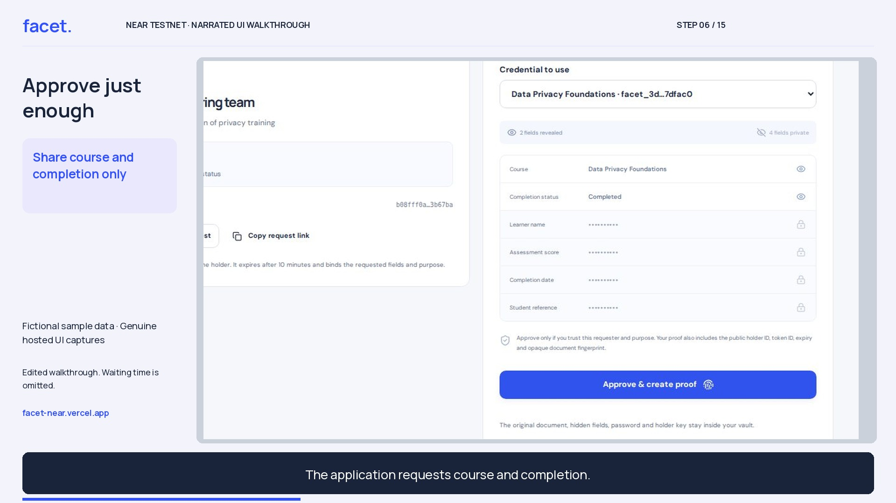

# Facet narrated demo

[Watch in the app](https://facet-near.vercel.app/demo) · [Download the MP4](https://facet-near.vercel.app/media/facet-demo-20261114.mp4) · [Open Facet](https://facet-near.vercel.app)

[](https://facet-near.vercel.app/demo)

The November 14 walkthrough edits genuine hosted UI screenshots into a 1920×1080 video with local narration, burned-in English captions, and downloadable [VTT](../public/media/facet-demo-20261114.vtt) and [SRT](../public/media/facet-demo-20261114.srt) captions. It is an edited walkthrough, not a continuous screen recording. Documents, issuer and training claims are fictional; signatures, BBS proofs and NEAR testnet receipts are real.

[Dated capture evidence](../deployments/demo-capture-2026-11-14.json) · [Video fingerprint and scene timings](../deployments/demo-video-2026-11-14.json) · [Private integration results](https://facet-near.vercel.app/near-verification.json)

[Hosted playback checks](../deployments/demo-playback-2026-11-14.json) verify the deployed video's SHA-256, MP4 range delivery, decoded audio, non-silent browser audio samples and 390px layout. All 31 application tests and the frontend build passed for this update.

## What the video demonstrates

1. A real NEP-413 login and existing wallet-to-holder binding through an injected NEAR Connect test wallet. The signing key stays in Node, outside the browser and published artifacts.
2. An encrypted local document, a self-recorded NFT and a fictional issuer-signed credential. Creating a document record does not authenticate the file or confer legal ownership.
3. Holder approval of course and completion, while name, score, date and student reference remain hidden. A separate browser imports and verifies the proof without receiving the original or opening a vault.
4. A real verification receipt, current issuer/expiry/revocation checks, and rejection of a fresh unused proof after a real revocation transaction.
5. Clearly labeled **agent permission previews**: selected fields, purpose, ten-minute expiry and two executions. This capture creates no agent grant and records no TEE dispatch.
6. The `/near` page's concrete wallet, contract and OutLayer roles, current partial verification status, contract address and exact worker fingerprint.

The wallet and direct-proof portions use separate fictional holder contexts. The edited sequence does not claim they are one uninterrupted browser session.

## Private execution status

**The complete private browser workflow has not passed.** Separate real testnet executions confirmed sealed copies, approved agent deliveries and owner recovery. Some OutLayer settlements arrive after the NEAR yield expires. Locked-vault external-agent use through live HTTP, full private browser coverage and manual Meteor/Intear login remain unverified. The video keeps these limitations visible.

The optional TEE copy stores the approved document, credential and holder key in persistent project-bound sealed storage. NEAR checks signed approvals, caller and capability restrictions, credential status, expiry, allowance and revocation. Agent recipients receive approved fields and required public credential bindings, without the original document or holder key. The TEE checks signed bindings and scope and delivers browser-prepared BBS presentations; it does not derive new proofs during execution. The example agent uses deterministic checks, with no language model or paid inference. Facet does not independently verify the complete TDX attestation chain.

## Try the implemented private workflow

Use fictional data and a testnet wallet. Treat these as experimental steps to try, not a passed end-to-end walkthrough. Wait for each private receipt to become `ready`; inspect pending or failed receipts before retrying.

1. Create a local vault, save an encrypted backup and issue the fictional training credential.
2. Open **Agent access**, connect a NEAR testnet wallet, sign in and bind it to the vault.
3. Approve the original, credential and holder-key TEE copy, then select **Save private TEE copy**.
4. Choose fields, purpose, expiry and execution allowance. Approve the permission.
5. Run the demo agent and inspect approved claims, the NEAR verification receipt and public private-job receipt.
6. Export private agent access, lock the vault, and try the external client with an execution remaining:

```bash
npm run agent:use -- --access /path/to/facet-private-agent-access.json
```

7. Unlock the holder vault and revoke the grant to refuse future requests.
8. On another browser, connect the bound wallet, approve **Recover copy**, and choose a new password. Wallet recovery restores each saved original and the holder key; local history and old capabilities still need the encrypted backup.

## Rebuild the video from public captures

The renderer reads only the public storyboard and captured screenshots. It verifies every source image's SHA-256 before rendering. Python 3, the pinned packages below and the committed Manrope font are sufficient; no wallet, recovery capability or paid service is needed to rebuild the video.

```bash
python3 -m venv .venv
.venv/bin/pip install -r scripts/product-demo-requirements.txt
mkdir -p reports/demo/tts-model
curl -fL https://github.com/thewh1teagle/kokoro-onnx/releases/download/model-files-v1.1/kokoro-v1.0.int8.onnx -o reports/demo/tts-model/kokoro-v1.0.int8.onnx
curl -fL https://github.com/thewh1teagle/kokoro-onnx/releases/download/model-files-v1.1/voices-v1.0.bin -o reports/demo/tts-model/voices-v1.0.bin
.venv/bin/python scripts/render-product-demo.py \
  --storyboard scripts/near-demo-storyboard-20261114.json \
  --capture deployments/demo-capture-2026-11-14.json \
  --report deployments/demo-video-2026-11-14.json \
  --work-dir reports/product-demo-near-20261114 \
  --model reports/demo/tts-model/kokoro-v1.0.int8.onnx \
  --voices reports/demo/tts-model/voices-v1.0.bin
```

Verify downloaded model hashes before running them:

| File | SHA-256 |
| --- | --- |
| `kokoro-v1.0.int8.onnx` | `ae315a79b623f244700e4afb9246c46a26066782e049ba174bf3ba433970ee9c` |
| `voices-v1.0.bin` | `bca610b8308e8d99f32e6fe4197e7ec01679264efed0cac9140fe9c29f1fbf7d` |

Kokoro-82M model weights use Apache-2.0; the `af_heart` voice is rendered locally on CPU. Manrope's SIL Open Font License is included in [the font license](video-tools/OFL-Manrope.txt). Dependencies are pinned in [the renderer requirements](../scripts/product-demo-requirements.txt). Model weights, intermediate WAVs and private fixtures are excluded from Git. The output includes H.264 video, AAC audio, loudness normalization and MP4 fast-start metadata. Speech is paced at 1.12× after synthesis; captions use proportional phrase timing within each narrated scene.

The capture helper, `scripts/capture-near-demo.ts`, requires privately configured isolated testnet fixtures under ignored `.local/`, including the stable encrypted holder fixture and its password in `.local/private-browser-password`. Preserve an already bound holder identity. The renderer needs none of these fixtures. For ordinary application checks, use `npm test` and `npm run build`; see [development](DEVELOPMENT.md).

## Historical recording

The [November 3 captioned recording](https://facet-near.vercel.app/media/facet-demo-20261103.mp4) and its [original test evidence](../deployments/demo-2026-11-03.json) remain available. That older primary-browser video shows the local vault and direct BBS flow. Encrypted-backup recovery and revocation in another browser were verified separately and appear in its evidence, rather than the recording. It does not demonstrate the newer wallet/TEE/agent workflow.
