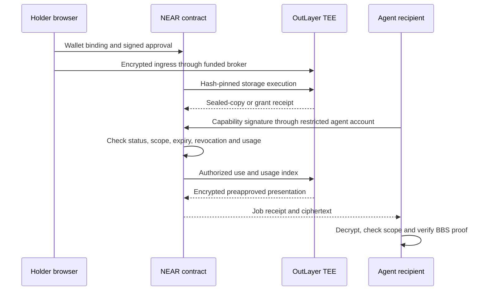

# Facet engineering reference

Private documents, wallet-authorized recovery and selectively disclosed credentials on NEAR testnet.

**App:** https://facet-near.vercel.app · **NEAR evidence:** https://facet-near.vercel.app/near

## Authorization and execution

The browser encrypts ingress before the backend stores it in OutLayer's keystore. Original files, holder seeds and complete credentials are absent from API request plaintext.

### Wallet identity

`src/Wallet.tsx` uses NEAR Connect with Meteor/Intear manifests and injected-wallet support. `api/wallet.ts` creates a NEP-413 challenge with a random nonce, expected recipient, callback URL, state and five-minute expiry. Signed HttpOnly cookies bind the challenge and session to the server.

The service verifies the signature and queries the NEAR access key at finality, requiring `FullAccess`. Function-call application keys cannot authenticate a recovery wallet. The holder separately signs the contract, wallet and holder binding. The relay records `bind_holder_wallet`; wallet and holder must not already belong to a different binding.

Login reveals public records and permits no automatic original-document disclosure. Recovery requires the bound wallet's own transaction.

### Contract permissions

`contracts/facet/src/index.ts` retains issuer status, holder-bound NFT records and single-use verification receipts. `vault.ts` adds:

- `configure_tee`: administrator configuration of project, worker SHA-256, broker, agent and cap.
- `reserve_private`, `claim_private_ingress`, `fail_private_ingress`, `execute_private`: holder-approved, one-time funded setup.
- `execute_agent`: configured-agent caller, capability signature and current credential/grant checks.
- `revoke_agent`: holder signature to revoke future dispatch.
- `bind_holder_wallet`, `get_wallet_holder`, `list_wallet_records`: signed binding and public discovery.
- `recover_private_copy`: owner wallet caller and fresh recipient public key.
- `on_private_execution`: self-only callback requiring exactly one promise result and expected job/operation/commitment bindings.

Approvals sign fixed ASCII fields: contract, operation, job, token, packet hash, exact field mask, expiry, allowance, purpose commitment, recipient authentication/delivery bindings, copy commitment, worker hash and project. NEAR verifies native Ed25519 signatures. The SDK 2.0.0 builder extension is guarded by its original source hash and adds only the missing native binding.

The contract reserves a job before funded ingress; input can be claimed only once. Job IDs bind approval hashes. Completed setup/execution retries retrieve existing jobs. Allowance is consumed before dispatch, including failed execution. Callback checks can withhold the Facet delivery when permissions change in flight but cannot erase an OutLayer response already available to its recipient.

Upgrade configuration initializes absent private counters while retaining records, request keys and existing private usage. Deployment evidence records source and WASM hashes.

### TEE storage and delivery

The Rust worker targets `wasm32-wasip2`. NEAR calls `outlayer.testnet.request_execution` with the registered project version hash, a 0.02 NEAR testnet compute deposit, 500 million instructions, 128 MB memory and 45 seconds of worker time.

The browser encrypts ingress with OutLayer's keystore public key using X25519, HKDF-SHA-256 and ChaCha20-Poly1305. A dedicated broker stores ciphertext with a policy binding the Facet predecessor, worker hash and ten-minute ingress expiry. Terminal setup attempts delete consumed ingress; cleanup failures leave encrypted, expiry-constrained ingress.

`workers/manifest.json` requests project-bound persistent encryption keys, predecessor storage and predecessor caller binding. The worker accepts only the deployed main/checks contracts.

| Operation | Behavior |
| --- | --- |
| `store_copy` | Check packet/document commitments and holder seed binding; persist a sealed document, credential and holder seed. |
| `store_grant` | Check exact presentation properties and disclosures, request/holder signatures, expiry, nonces and delivery/authentication bindings; persist the approved packet. |
| `use` | Read the saved copy and grant, check and atomically consume the usage index, then encrypt the corresponding presentation for the recipient. |
| `recover` | Encrypt the saved copy for the fresh owner-browser key named in the wallet-authorized NEAR request. |

The browser prepares one real BBS presentation per permitted execution. **The TEE does not verify BBS mathematics or derive new presentations during use.** It validates signed bindings and exact disclosure scope. Recipients independently verify proofs in the browser or external client; the backend checks them again before recording a verification receipt.

Agent exports contain private delivery capabilities. Requests carry signatures binding grant and job IDs; delivery keys stay with recipients. The hosted agent's NEAR key permits only `execute_agent` on Facet. That hosted key alone cannot authorize a disclosure without the approved capability.

The demo agent is deterministic. No model inference or autonomous tool execution is implemented. Other agents can use `scripts/agent-client.ts` to integrate the scoped API.

### Recovery

A browser generates a fresh X25519 key and asks its wallet to sign `recover_private_copy`. The contract checks the wallet-to-holder binding. The TEE encrypts the copy to that public key. The browser checks holder and document fingerprints before creating a new AES-encrypted vault or merging into the same unlocked holder vault.

Ephemeral recovery material stays in sessionStorage across wallet redirects and is removed after completion. Replacing a locked local vault requires explicit consent. Recovery restores saved documents and the holder key; local history and previous agent delivery keys require an encrypted backup. Fingerprints cannot reconstruct unsaved documents.

## Local vault and BBS proofs

The IndexedDB vault uses AES-256-GCM, a fresh IV per save, a random salt and PBKDF2-SHA-256 with 600,000 iterations. It supports locking, five-minute idle lock, search, encrypted backup and restore. Passwords stay local. Optional TEE consent allows the holder key to leave the browser inside an encrypted packet.

Personal uploads are self-recorded and unverified. Fictional Facet Test Academy credentials use Digital Bazaar BBS 3.1.0 and the BLS12-381 SHA-256 suite. Signed messages cover holder, token, course, achievement, learner, score, completion date, expiry, fingerprint and reference.

Presentations reveal requested credential fields plus mandatory public holder/token/type/expiry/fingerprint bindings. Unknown presentation, request and disclosure properties are rejected. Holder signatures bind the exact presentation; signed requests bind audience, purpose, fields and nonce.

Verification checks BBS mathematics against the registered issuer and current NEAR status. The relay's onchain receipt method rechecks issuer activity, expiry, revocation and nonce reuse. BBS verification runs outside the contract. A compromised verification relay could record a false result; `scripts/check-proof.ts` independently verifies cryptography and chain status.

## Privacy and trust boundaries

NEAR exposes wallet/holder bindings, token IDs, agents, field masks, expiry, allowance, revocation, fingerprints and transaction activity. Output ciphertext length and job timing are public. Document privacy does not make activity anonymous.

OutLayer testnet availability and prompt settlement are required. A worker may run after its NEAR yield has expired; Facet then records a failed job and does not mark the copy or grant ready. OutLayer, its keystore and attestation infrastructure, and project administrators are trusted. Project-bound keys persist across versions: an administrator can publish other code with access to them. Hash pinning identifies the approved version without removing future administrator access. Facet records OutLayer execution IDs but does not independently verify the complete TDX attestation chain.

Recipients can retain disclosures. Revocation blocks future dispatch but cannot erase retained data or reliably cancel an in-flight delivery. Locking leaves grants active. Requester labels are self-declared; signatures authenticate packages rather than institutions.

All demo claims and issuer identities are fictional. This is a custom credential schema, not full W3C VC interoperability or arbitrary-document authentication. No numerical predicates or legal property transfers are implemented. Compromised device/application code can access an unlocked vault, and backups permit offline password guessing. Wallet keys authorize powerful recovery. No independent security audit has been performed.

## Limits and evidence

Local vaults permit eight files, 5 MB per file and approximately 20 MB total. TEE originals are limited to 64 KiB. Grants permit one to three executions for five, ten or fifteen minutes. Main private execution is capped at 32 jobs per UTC day and 2,048 total; isolated checks use a 100-job daily cap. Minting is capped at 40 records per day and 500 total.

`deployments/testnet.json` and `private-testnet.json` contain public configuration, source hashes, key restrictions and deployment receipts. `private-checks.json` contains the native NEAR/OutLayer suite; `/near-verification.json` separates it from browser and local interoperability evidence. The complete private browser workflow has not passed, and locked-vault external-agent use through live HTTP, manual wallet compatibility and the full hosted private browser run are unverified. Original release evidence remains in `verification.json`. See [development commands](DEVELOPMENT.md), [submission wording](SUBMISSION.md) and the [demo](DEMO.md).

## References

- [NEAR documentation](https://docs.near.org/)
- [NEP-413 signed messages](https://github.com/near/NEPs/blob/master/neps/nep-0413.md)
- [OutLayer source and documentation](https://github.com/out-layer/outlayer)
- [Digital Bazaar BBS](https://github.com/digitalbazaar/bbs-signatures)
- [W3C VC data model 2.0](https://www.w3.org/TR/vc-data-model-2.0/)
